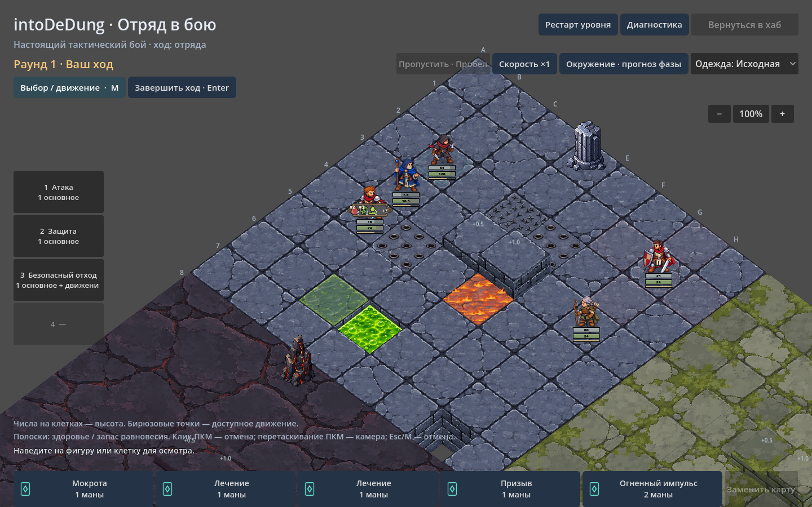

# Читаемость полос и горизонтальные статусы над бронёй

По последнему уточнению U статусы расположены **горизонтально**, ближе к полосам,
непосредственно над бронёй. Вертикальное размещение отменено. Ряд следует
авторскому смещению полос класса; hover-only и общая подложка№4 сохранены.

- Цифры HP/брони отделены от рамки свободным пикселем заливки сверху и снизу.
  Полосы остаются48×9 экранных px и не уменьшаются с камерой. Тонкие штрихи
  малого шрифта усилены без увеличения растра.
- Пять полевых статусов получили чистые SVG-контуры и сглаженную отрисовку20px.
  Кровь — капля, огонь — пламя, яд — череп, кислота — капля над лужей,
  мокрота — вода с волной. Рамочные24 PNG карточки и осмотра прежние.
- До трёх значков и `+N` удерживают ряд компактным; полный список и точные
  количества остаются в подсказке/карточке. Стаки и сроки не объединяются.

Поведение и геометрия — [контракт](../../BATTLE_PRESENTATION_REWORK.md),
выбор — [ART](../../ART_DIRECTION.md), устройство — [архитектура](../../ARCHITECTURE.md).
Боевые механики, гамма поля, классы и арт персонажей не менялись.

## Кадры и проверка

Неизменённые GPU PNG из изолированного проекта с настоящими пятью классами:

- Текущий бой: [100%](battle-100.png), [75%](battle-75.png), [canvas113%](battle-canvas-113.png).
- Плотная группа: [100%](dense-100.png), [75%](dense-75.png).

Количества и состояния заданы опубликованным тестовым DTO. Плотная группа —
визуальная расстановка, без перемещения бойцов в ядре. Это не сыгранный сценарий.
[Probe](probe.gd.txt) проверяет30 точных RGBA совпадений полос после zoom/canvas
и восемь масок непрозрачных пикселей соседних тел при100/75, без перекрытия новым
рядом. Маска использует родные текстуры, материал и transform; idle фиксирован
до синхронизации. Полупрозрачные AA-края закономерно смешиваются с фоном.

Isolated import/startup и целевые GPU suites прошли. Точные свежие результаты
и SHA — [manifest](manifest.json), [probe.json](probe.json).
Логи, маски, галереи и разбор исправленной тестовой сцены:
`test_reports/status-readability-20261111/`.

Full/core, ручные F5/движение/zoom/OS-DPI/usability/performance не запускались.
Технические проверки и независимое ревью не заменяют отзыв U о читаемости в бою.
