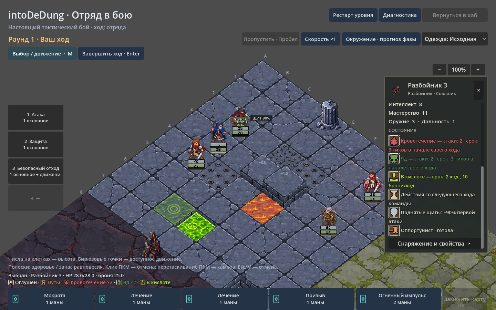

# Упрощённые значки и hover-подложка №4 — внедрение, 2026-11-08

Main; base `d4b0ef80c8b4c09a7a8e7d571f4b100d5287bc2b`.
U принял [24 силуэта](../status-icons-silhouette-20261108/README.md) и
[цвет компактной подложки №4](../status-hover04-color-20261108/README.md), поручил внедрить.
Выбор — [ART_DIRECTION](../../ART_DIRECTION.md), поведение —
[показ](../../BATTLE_PRESENTATION_REWORK.md#информация-на-поле--состояния-r06r08r09r15)
и [HUD](../../BATTLE_HUD_SCENES_V1.md#значки-состояний-a--2026-11-08).

## Результат

- Новый [рабочий каталог](../../../assets/art_presets/approved/status_icons_silhouette_v1/README.md):
  исходные16px скопированы побайтно;32px — точное nearest2×;24 ID и API прежние.
- Карточка и нижний осмотр используют новые силуэты на прежних квадратных рамках
  дерева/железа. Прежние A/framed-v1 не изменены.
- На фигуре общая панель №4 появляется только при hover тела/ряда. Без наведения,
  при пустом ряде и смерти её нет; выбор/открытая карточка её не удерживают.
- Панель расширяется с числом эффектов, шаг сокращается16→12px; значки не уменьшаются.
  Все числа рисуются после всех значков. `+N` имеет отдельное место без нахлёста.
- Якорь у полос сохранён. Макет над головой не переносится в сцену; общая сортировка,
  picker, ПКМ-карточка, неподвижность поля/руки и проекция DTO остаются прежними.

| Видимых значков | Нахлёст | Ширина панели |
|---|---|---|
| 1 | 0px | 40px |
| 2 | 1px | 55px |
| 3 | 2px | 68px |
| 4 | 3px | 79px |
| 5 | 4px | 88px |
| 5 + переполнение | 4px; перед `+N` зазор2px | 116px |

Эта таблица — обзор; точные координаты и критерии принадлежат контракту показа.
PNG панели126×20 — crop прозрачных внешних полей, без изменения её RGBA.
StyleBoxTexture сохраняет торцы12px, растягивая середину.

## Свидетельства

Все PNG ниже — неизменённые захваты GPU из изолированного текущего проекта:

- Hover [100%](battle-hover-100.png) / [75%](battle-hover-75.png),
  без hover [100%](battle-idle-100.png) / [75%](battle-idle-75.png).
- [Состояния клетки](tile-100.png), [каталог16/32](catalogue-16-32.png).
- Пять эффектов [100%](density-5-100.png) / [75%](density-5-75.png),
  [переполнение](overflow-hover.png).

H1-кадры используют тестовые DTO представления поверх настоящей сцены боя.
Они не заявляют, что все показанные статусы были получены в сыгранном бою.
Синтетическое переполнение не добавляет механик. Прежние счётчики могут перекрывать
часть силуэтов; окончательная читаемость на реальном поле требует отзыва U.

## Проверки

`python tools/art/build_status_silhouette_icons.py --check`:100 детерминированных
выходов,99 PNG/sidecars; raw/2×/композиция и импорт lossless, без mipmaps,
fix_alpha_border/premult_alpha. Импорт выполнялся только в изолированной копии;
созданные движком sidecar скопированы в рабочий каталог с проверенными настройками.

Свежие isolated import/startup PASS. GPU: counter64, icons442, status158, vital278,
card119, hud_input163, camera112, execution61, visual_scene106 — **1503/0**.
Headless: counter18 + status96 — **114/0**. Проверены1–5/overflow, hover on/off,
чёткие счётчики100/75%, RGBA текстур, подбор строки, изоляция state/RNG/counters.
Независимое ревью и финальные проверки —
`test_reports/status-silhouette-integration-20261108/validation.json`.

Full/core, ручные F5/движение/zoom/DPI/performance не запускались.
Прежние fire/spikes/builders A/framed/launcher gates и APPROVE не объявляются повторёнными.
Новых генераций в этом этапе нет. Следующая уже порученная задача — аудит хаба и план.
