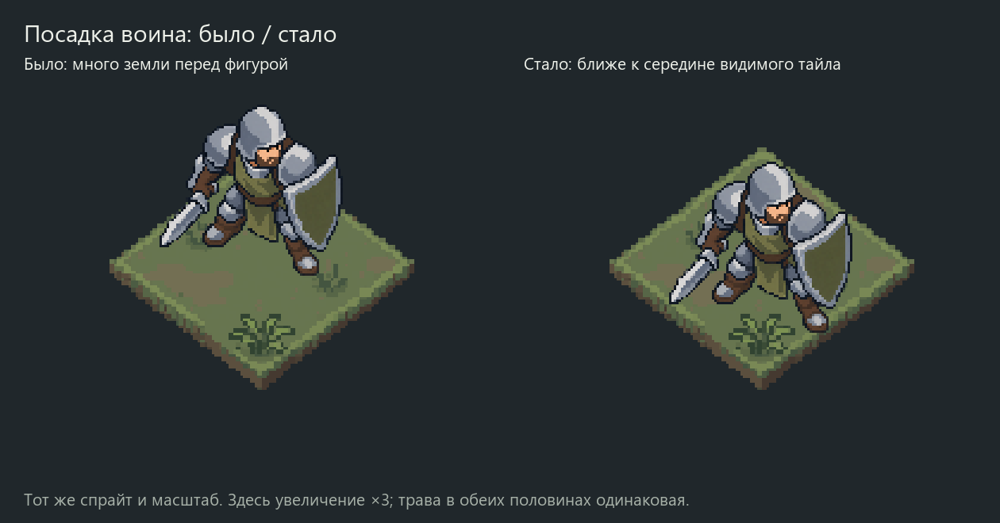

# Чуть пышнее трава, посадка ближе к центру — 2026-10-09

Поручение: у воина слишком много свободной земли перед собой; тайлы сделать
чуть пышнее. Установки и приёмка — [ART_DIRECTION](../../ART_DIRECTION.md).

- [Однородные поля K/L/M и смесь поровну](all-fields.png).
- [Смесь K/L/M](mixed-KLM.png): по12 клеток каждого.
- [Смеси с половиной прежней A](all-mixed.png): A18 + новые18.
- [Крупные планы тайлов](tiles-closeup.png).
- [Контроль клетки и её центра](placement-check.png).

В этой папке K/L/M — следующие версии прежних K/L/M. K и L получены через
image_gen из `terrain-retry-20261009/tile-K/L-clean.png`: существующие пучки
стали шире, без увеличения их количества. M доработан PixelLab из прежнего
`tile-M-refined.png`. Первый M2 дал чрезмерно большой передний пучок;
выбран M3 после отдельного уменьшения пучка. M2 оставлен для аудита.
Исходники и точные запросы сохранены.
Строгое совпадение RGB не требуется; мягкая родственная палитра сохранена.

## Посадка

Светлый статичный №4 не перерисовывался. Источник —
`../quiet-clusters-20261009/defender-soft-original.png`, видимая высота72px.
Прежний монтаж ставил середину контактов ног точно в центр клетки, отчего
силуэт оказывался выше и оставлял много земли перед собой.

Новый монтаж сдвигает тот же спрайт на4px вправо и24px вниз. Центр его видимого
bbox —(449.5,369), центр выбранной клетки —(450,375). Точки контакта подошв
остаются внутри ромба; их середина уже не является центром клетки.
Погрешность округления считается относительно новой цели опоры, а не центра.
Поправка предложена для визуального отзыва; игровой anchor не меняется.
В сравнении до/после один и тот же новый тайл, изменено только положение воина.

## Геометрия и воспроизведение

Верх128×96, шаги(64,48)/(-64,48), боковины≤8px в монтаже, nearest.
K/L — большие растры, M —96×96. Это сравнение ракурса4:3, не доказательство
точной3D-камеры генераторов или финальной общей пиксельной сетки ассетов.
`geometry.json`, `compose.py`, `checks.json` сохраняют измерения/монтаж/проверки.
Pillow и Windows Segoe UI; исходники и прежние раскладки читаются из соседних пакетов.
Раскладки и число клеток сохранены, чтобы сравнивать правку без смены окружения.

## Проверки и границы

Скрипт проверяет высоту72px, контакты внутри ромба, округление и отсутствие
изменений фона вне alpha фигуры. Проверены PNG, неизменность солдата и раскладки;
композиции просмотрены. Независимое ревью APPROVE.
Отчёт — `test_reports/terrain-fluffy-20261009/`.
image_gen2; PixelLab2 списания4956→4954; Retro Diffusion0.
Первый запрос PixelLab отклонён HTTP422 из-за описания длиннее500 символов,
без задания/списания. Укороченный запрос и отдельная правка завершены.
`generation-usage.json` содержит итог, безопасные запросы сохранены отдельно.

Игровой код/сцены не менялись, Godot/core/full/render/F5 не запускались.
Статичная фигура ранее одобрена; новые тайлы и посадка ещё не приняты.
Повторяемость пучков, более тёмная A, анимации и интеграция остаются открыты.
