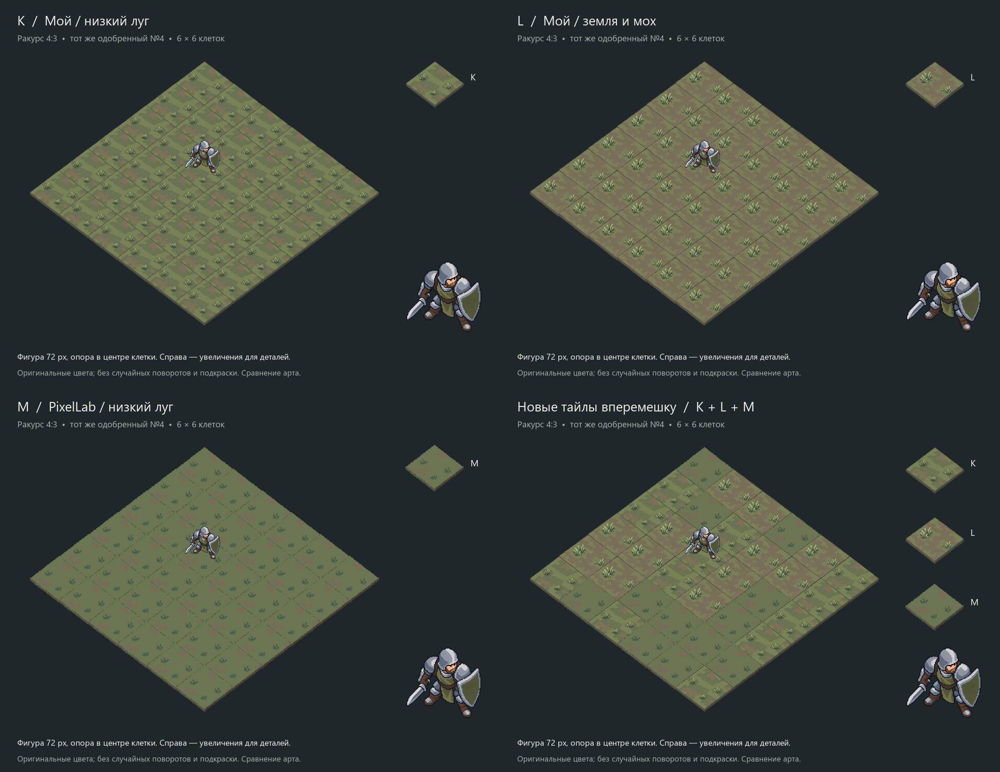

# Повторная серия тайлов K/L/M — 2026-10-09

Пользователь отклонил тайлы H/I/J и поручил новые варианты через собственную
генерацию ведущего и PixelLab, затем явно попросил однородные и смешанные
композиции с воином. Светлый статичный №4 одобрен («пойдёт») и **не менялся**.
Установки и границы приёмки — [ART_DIRECTION](../../ART_DIRECTION.md),
учебные выводы — [PIXEL_ART_GUIDE](../../PIXEL_ART_GUIDE.md).

## Сравнения

- [Крупные планы K/L/M и сохранённый воин](tiles-closeup.png).
- Однородные поля6×6: [K](field-K.png), [L](field-L.png), [M](field-M.png).
- [Только новые тайлы вперемешку](mixed-KLM.png): по12 K/L/M.
- [Половина прежней земли A, остальные новые](mixed-AKLM.png): A18/K6/L6/M6.
- [Одинаковые раскладки A+K, A+L, A+M](all-mixed.png);
  отдельные [A+K](mixed-AK.png), [A+L](mixed-AL.png), [A+M](mixed-AM.png).
- [Контроль центра опоры](placement-check.png).

K — собственный image_gen: низкий луг с крупными приглушёнными пятнами и тремя
малыми пучками. L — собственный image_gen: больше земли, два разновеликих пучка.
M — PixelLab96×96: более сдержанная переработка концепта K с небольшими пучками.
Это три арт-кандидата; одинаковый мотив при сплошном повторении всё ещё заметен.
M спокойнее по контрасту, у K/L растения выразительнее. Прежняя A заметно темнее
новых тайлов, поэтому смеси с ней сильнее распадаются на клетки. Выбор тайлов открыт.

Половина A в соответствующих смесях сохраняет прежние18 позиций из раскладки
`tiles-20261009/mixed-A50-CDE-layout.json`. Чистая смесь K/L/M перемешана один раз
фиксированным seed20261009. Вращения и случайная подкраска не скрывают повторение.
Фигура на всех полях одна и та же, клетка(2,2), видимая высота72px, середина
контактов подошв в центре клетки. Крупный образец справа не задаёт размер бойца.

## Что изменено в подходе

Вместо одинаковых угловых значков и непрерывной травяной каймы — неровные массы
земли/низкой травы, пучки внутри поверхности и более сдержанный контраст.
Первые собственные K/L имели слишком мелкую фактуру; отдельные image_gen-правки
объединили фон в крупные пятна. Общий ритм проверяется на поле с одобренной фигурой.

Первые независимые PixelLab M/N дали яркую зелень и слишком толстую землю.
Повторные запросы получили подготовленные концепты K/L и приглушённую палитру.
У повторного N осталась россыпь мелких точек; правка создала тёмные контуры,
похожие на трещины. **Вся ветка N отбракована и сохранена для аудита, в основные
композиции не включена.** Новые запросы после этого не делались.

## Происхождение и воспроизведение

| Кандидат | Основной исходник | Происхождение |
|---|---|---|
| K | `tile-K-clean.png` | image_gen, упрощение своего `tile-K-original.png` |
| L | `tile-L-clean.png` | image_gen, упрощение своего `tile-L-original.png` |
| M | `tile-M-refined.png` | PixelLab Pixflux96, вход — концепт K после подготовки |

`*-request.json` сохраняют точные тексты и безопасные параметры; base64 заменены
локальными ссылками. Запросы image_gen также называют роль каждого референса.
Исходная методичка пользователя и геометрический образец из предыдущего пакета
использованы как референсы; солдат не передавался на новую генерацию.

`tile-M/N-input-96.png` — технические входы: crop и nearest до84×67, размещение
на96×96. Параметры подготовки записаны в соответствующих запросах; локальной
дорисовки/шумоподавления нет. `trial-palette` содержит семь прежних цветов из
образца Into the Breach и три предлагаемых оттенка, которые **не** заявлены
извлечёнными из игры. Точные RGB не являются общим требованием серии.

Большие K/L —1448×1086, не native96. Их измеренные верхние грани нормализованы
в монтаже до128×96; M — native96, его верх84×63. Шаги сетки(64,48)/(-64,48),
боковины в показе ограничены8px. Исходные PNG сохранены без изменений.
Это сравнение выбранного ракурса4:3, не доказательство точной камеры генератора
и не утверждение финальной общей пиксельной сетки игровых ассетов.

`geometry.json`, `compose.py`, `checks.json` — геометрия, воспроизводимый монтаж,
хеши/размеры/раскладки/опоры. Требуются Pillow и Windows Segoe UI.
Исходник одобренного №4 читается из предыдущего пакета; SHA проверяется.
Округление центра учитывает реальные размеры уменьшенного PNG, ошибка≤0.5px.

PixelLab:5 списаний,4961→4956 — две исходные пробы, две переработки, правка N.
image_gen:4 вызова — K/L и две правки; отдельный денежный usage не возвращён.
Retro Diffusion не использован. Ответы/проверки — `test_reports/terrain-retry-20261009/`.

PNG/alpha/SHA/раскладки/опоры/фон проверены, композиции просмотрены.
Независимое ревью APPROVE. Игровой код/сцены не менялись;
Godot/core/full/render/F5 не запускались. Приняты ракурс4:3 и статичный №4;
тайлы, финальная пиксельная сетка, анимации и интеграция остаются открыты.
