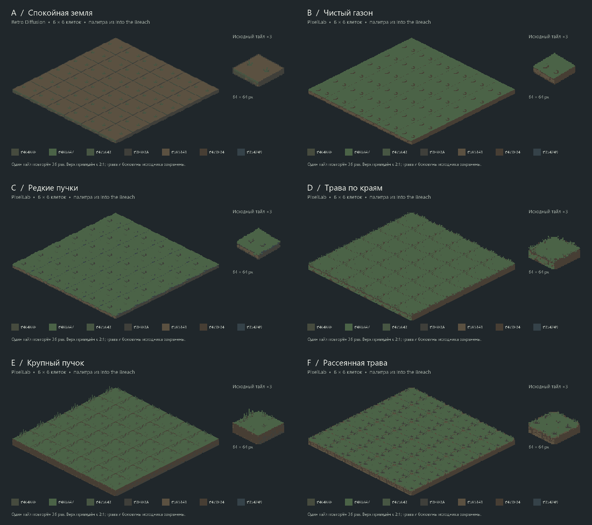

# Пробы травяных тайлов — 2026-10-09

Поручение и художественные установки — [ART_DIRECTION](../../ART_DIRECTION.md).
Это сравнение кандидатов; ни один не подключён к игре и не принят финальным артом.

По следующему поручению собрано [смешанное поле](mixed-A50-CDE-field.png):
18 клеток A и по 6 C, D, E, перемешанные по всему полю. Точная раскладка —
[JSON](mixed-A50-CDE-layout.json). Новых генераций/расходов нет; использованы
те же исходники и проекция. Состав/SHA проверены, PNG просмотрен локально.
Отдельное ревью и Godot для этого монтажа не запускались.

| Вариант | Провайдер / режим | Поле 6×6 | Исходник | Наблюдение |
|---|---|---|---|---|
| A — спокойная земля | Retro Diffusion / RD Pro simple | [поле](A-field.png) | [PNG](A-original.png) | Спокойный центр и читаемые края, преобладает земля |
| B — чистый газон | PixelLab / Pixflux | [поле](B-field.png) | [PNG](B-original.png) | Самая спокойная зелёная основа; два тёмных штриха |
| C — редкие пучки | PixelLab / Pixflux | [поле](C-field.png) | [PNG](C-original.png) | Рекомендация для дальнейшего выбора: компактная узнаваемая трава |
| D — трава по краям | PixelLab / isometric tile | [поле](D-field.png) | [PNG](D-original.png) | Бахрома создаёт шум на стыках |
| E — крупный пучок | PixelLab / isometric tile | [поле](E-field.png) | [PNG](E-original.png) | Более высокий силуэт травы, заметный повтор |
| F — рассеянная трава | PixelLab / isometric tile | [поле](F-field.png) | [PNG](F-original.png) | Самый насыщенный деталями из оставленных |

## Как сравнивать

Каждый оригинал 64×64 с настоящим alpha; исходные байты не изменены.
На поле один тайл повторён 36 раз без случайного поворота, окрашивания и вариантов.
Верхняя грань приведена к общей проекции 2:1, 128×64; масштаб по осям задаётся
вручную выбранным прямоугольником верхней грани из `checks.json`. В поле размещён
весь исходник: выступающие травинки и боковины сохранены. Ничего не дорисовано
между клетками. Фильтр nearest; рядом исходник ×3 без нормализации геометрии.
Обзор уменьшен nearest вдвое; оценивать мелкие детали лучше на отдельных полях.
Это составленные PNG, не рендер Godot и не проверка слоёв/высот в бою.

Повтор двух одинаковых пучков заметен и у B/C. Эти картинки намеренно показывают
его, а не маскируют чередованием ассетов. Выбор рисунка, разнообразие размещения,
игровой контур/выделение, анимация и интеграция требуют следующего решения.
Рекомендация C не равна пользовательской приёмке; B ещё спокойнее.

## Происхождение и палитра

`palette.json` фиксирует внутренний путь и SHA-256 травяного PNG из локальной
Into the Breach. `itb-grass-palette.png` содержит только семь выбранных RGB.
Текстура игры не отправлялась провайдерам и не включена в этот пакет.
Параметры отправленных запросов без секрета/объёмного base64 — `A-request.json`…`F-request.json`;
поле `palette_file` указывает переданные цвета, `palette_transport` — кодирование.
Палитра задавалась отдельным входом провайдера; последующей перекраски не было.
У всех шести PNG проверено: 64×64, прозрачность, 0 непрозрачных цветов вне палитры.
Проверки и SHA-256 оригиналов — `checks.json`.

Retro Diffusion: одна генерация $0.18, остаток $0.14; бесплатная оценка второго
RD Pro запроса $0.18 показала нехватку остатка, его не отправляли. PixelLab:
7 успешных генераций подписки, остаток 4991 из 5000; в сравнении оставлены 5.
Два первоначальных похожих варианта с бахромой сохранены только в отчёте.
Четыре первые изометрические задачи с PNG-палитрой завершились ошибкой декодирования;
после сверки ответа использован raw RGBA 64×64. Pixflux принимает PNG-палитру;
его единственный запрос с raw RGBA отклонён валидацией до генерации.
Изменение баланса PixelLab 4998 → 4991 соответствует семи успешным генерациям.

Полные запросы/ответы, ошибки, balance до/после и скрипты подготовки/сборки:
`test_reports/tile-art-20261009/`. Секреты в этот пакет не входят.
API сверены по [PixelLab OpenAPI](https://api.pixellab.ai/v2/openapi.json) и
[официальным примерам Retro Diffusion](https://github.com/Retro-Diffusion/api-examples).
