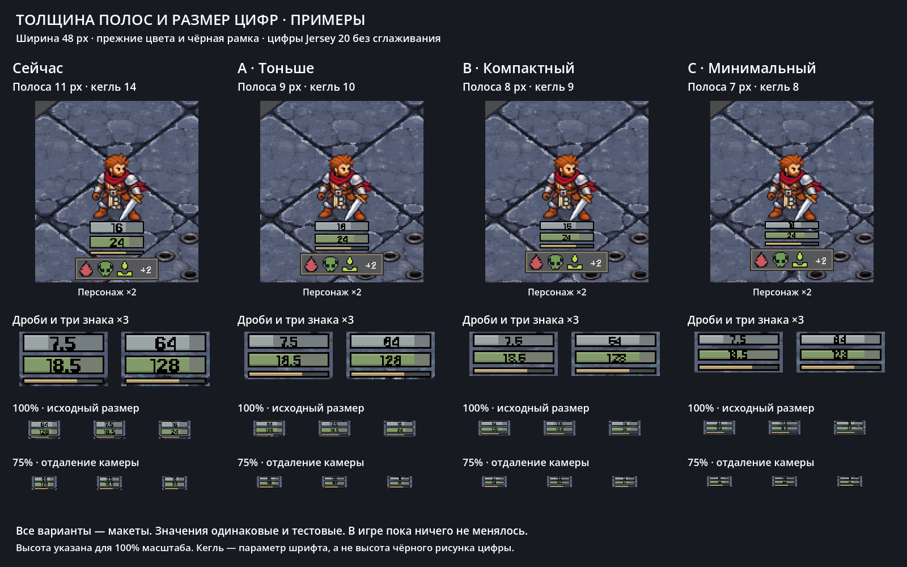

# Более тонкие полосы и меньшие цифры — 2026-11-09

База `f291819da3a80c18e16cadf2e80b2fa33e3f5ebf`. U запросил примеры меньших
чисел внутри HP/брони и уменьшения толщины полос. **Все варианты — P, без
выбора и внедрения.** Текущая игра сохраняет прежние полосы48×11 и кегль14.

| Вариант | Высота каждой полосы при100% | Кегль100% | Чёрный растр цифр100% | Кегль/растр75% |
|---|---:|---:|---:|---:|
| Сейчас |11px|14|8px|10 /6px|
| A |9px|10|6px|7 /4px|
| B |8px|9|5px|6 /4px|
| C |7px|8|5px|5 /3px|

Кегль — размер шрифта, не высота видимой цифры. Значения растра измерены
самим Godot по строке `0123456789.` с теми же настройками FontFile.
В новых вариантах цифры центрируются по измеренному растру и дополнительно
уменьшаются, если не помещаются между рамками. Поэтому у C при75% кегль
снижается с расчётных6 до5. Текст чисел не округлялся и не сокращался.

Ширина48, приглушённый зелёный HP, металлическая броня, чёрные цифры/рамки
и двухпиксельный промежуток прежние. Броня остаётся на прежнем верхнем якоре;
HP, равновесие и ряд статусов поднимаются вслед за уменьшением общей высоты.
Равновесие остаётся второстепенной янтарной полосой с прежней толщиной.
Шрифт Jersey20 без AA; растеризация сразу в экранном кегле, без растягивания.
Новый арт/гамма не создавались и не менялись.

Для контекста повторён предложенный [компактный ряд C](../status-compact-c-20261109/README.md)
с3 значками/+N. **Он тоже не внедрён:** в текущей игре весь статусный ряд
по-прежнему скрыт без hover. Его счётчики здесь не менялись.
Название размера C на этом листе относится к полосам, а не к прежней компоновке.

Оценка ведущего: **B — предпочтительный компромисс для запроса U**;
A оставляет больше пространства вокруг цифр. C показывает нижнюю границу:
пять рядов пикселей у100% и всего три у75% заметно затрудняют чтение.
Это визуальная оценка макета, не подтверждённая пользовательская приёмка.

## Полные кадры

| Масштаб | Сейчас | A | B | C |
|---|---|---|---|---|
|100%|[Кадр](current-100.png)|[Кадр](A-100.png)|[Кадр](B-100.png)|[Кадр](C-100.png)|
|75%|[Кадр](current-75.png)|[Кадр](A-75.png)|[Кадр](B-75.png)|[Кадр](C-75.png)|

На листе персонаж увеличен2×, пары дробных/трёхзначных чисел3× nearest;
нижние две строки имеют исходный размер пикселей захвата100% и75%.
Масштаб отображения самого PNG в приложении пользователя может отличаться.
Кадры показывают настоящую сцену с пятью классами, тестовые DTO союзников
HP128/160,18.5/32,24/32 и броню64/80,7.5/24,16/24; core/RNG неизменны.
Увеличенные одиночные детали получены скрытием соседних фигур только для захвата.

13 PNG:8 полных,4 исходных crop и1 лист. [Manifest](manifest.json),
[receipt](probe.json), [probe](probe_sizes.gd.txt),
[рисование статусов](mock_helpers.gd.txt), [запуск](run_stage.py.txt).
Помощник запуска зависит от существующего workspace-файла
`test_reports/status-silhouette-integration-20261108/run_checks.py`.

## Проверки и границы

Godot4.7.2/D3D12 Forward Mobile, один runner в прогретой isolated-копии.
Свежая GPU-проба PASS: кадры100/75%, сохранность core/RNG и верхних якорей,
измерение глифов. Временный patch isolated-файла восстановлен побайтно;
production-код, ассеты, сцены и импорты не менялись. Только в макете статусный
StatusHud поднят до UI_PREVIEW+1 над рельефом, как в предыдущем примере C.
Это не готовая реализация новой геометрии/picking/forecast/lifecycle.

Отчёт: `test_reports/vital-bar-sizes-20261109/validation.json`.
Import/startup, прежние suites/APPROVE, full/core, ручные F5/движение/zoom/
OS-DPI/performance не повторены. Проверка не заменяет отзыв U о читаемости.
Следующий шаг — выбор размера; не внедрять автоматически.
