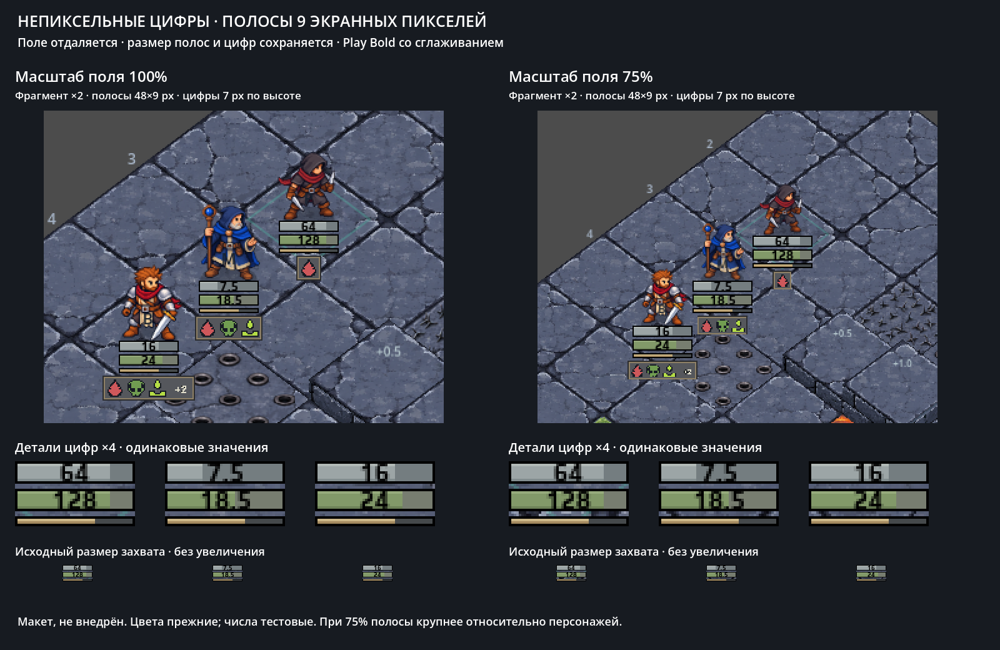

# Непиксельные цифры и полосы9 экранных px — 2026-11-09

База `4803b58f1878afde941592682dfd1cb19f428988`. По U показан пример при100%
и75%: непиксельные цифры внутри полос9px сохраняют размер при отдалении.
**Это P-макет, без приёмки и внедрения.** Runtime пока сохраняет48×11
базовых px/Jersey20 и скрывает весь ряд статусов без hover.
Runtime-база4803 сохранена; пакет записан поверх34131d62 (отдельное решение
по навигации хаба, только документы). Между ними runtime-файлы не менялись;
2042 исходных файла пробы сверены с текущей рабочей копией.

| Параметр |100%|75%|
|---|---:|---:|
| Полоса HP/брони, экранные px |48×9|48×9|
| Чёрная внутренняя рамка |1px|1px|
| Кегль Play Bold |11|11|
| Фактическая высота растра цифр |7px|7px|
| Равновесие |48×4|48×4|

Использован уже имеющийся `assets/ui/combat_fonts/combat_letters.ttf`:
Combat Lettering, производный Play Bold700, SIL OFL1.1.
[Происхождение](../../../assets/ui/combat_fonts/README.md).
Приватная копия FontFile: grayscale AA, NORMAL hinting, целое экранное
позиционирование, oversampling1. Размер и baseline выбраны по GPU-растру
строки `0123456789.`; цифры занимают7px между рамками, числа не округлены.
Параметры соответствуют [API Godot](https://docs.godotengine.org/en/4.6/classes/class_textserver.html#enum-textserver-hinting).

Верхняя точка стека следует за персонажем. Полосы рисуются в экранных
координатах, поэтому при75% становятся крупнее относительно фигуры.
Сохранены цвета металлической брони/зелёного HP/янтарного равновесия,
чёрные числа и рамки, два пикселя между полосами. Новый арт/гамма не менялись.
Компактный статусный ряд C на фоне — [прежнее предложение](../status-compact-c-20261109/README.md),
также не внедрён; размеры самих значков продолжают следовать камере.

На листе поле увеличено2×, детали цифр4× nearest; нижняя строка — исходные
пиксели захвата без увеличения. Это сохраняет одинаковое относительное
увеличение для двух масштабов. Масштаб отображения PNG приложением может
отличаться. Сглаживание на увеличенных деталях выглядит как серые пиксели;
оценивать читаемость нужно также по нижней строке и полным кадрам.

Полные кадры: [100%](battle-100.png), [75%](battle-75.png).
Настоящее поле первого боя и пять классов, синтетические значения союзников:
HP128/160,18.5/32,24/32; броня64/80,7.5/24,16/24; равновесие4/12.
Это пример показа, не результат сыгранного боя или проверка баланса.

## Проверки и границы

Godot4.7.2/D3D12 Forward Mobile, один runner в прогретой isolated-копии.
GPU-проба PASS: у всех5 бойцов HP/броня/равновесие дали15 побайтных RGBA
совпадений100%↔75%; все рамки проверены с четырёх сторон, core/RNG неизменны.
Это подтверждает постоянство размера/растеризации в показанной сцене,
но не заменяет пользовательскую оценку читаемости.

Только в isolated-копии штатные полосы заменены тестовым дочерним renderer
на UI_PREVIEW+1; статусный ряд также поднят над рельефом. Геометрия узлов,
ядро и picking не менялись. После кадров исходник восстановлен побайтно;
root production-код/сцены/ассеты/импорты не менялись. Новый renderer —
рисунок для выбора, без нового forecast/picking/lifecycle. При внедрении
нужно отдельно решить слои, перекрытия соседей, отдаление дальше75%,
другие разрешения/DPI, длинные числа и реакции/смерть.

Import/startup, прежние suites/APPROVE, full/core, ручные F5/движение/zoom/
OS-DPI/performance не повторялись. Фиксированный размер не проверен во всех
состояниях игры. Следующий шаг — отзыв U, без автоматического внедрения.

Три оригинальных PNG и SHA: [manifest](manifest.json), [receipt](probe.json).
Исходники: [probe](probe_fixed.gd.txt), [статусы](mock_helpers.gd.txt),
[запуск](run_stage.py.txt). Runner использует существующий workspace helper
`test_reports/status-silhouette-integration-20261108/run_checks.py`.
Отчёт: `test_reports/vitals-smooth-fixed-20261109/validation.json`.
