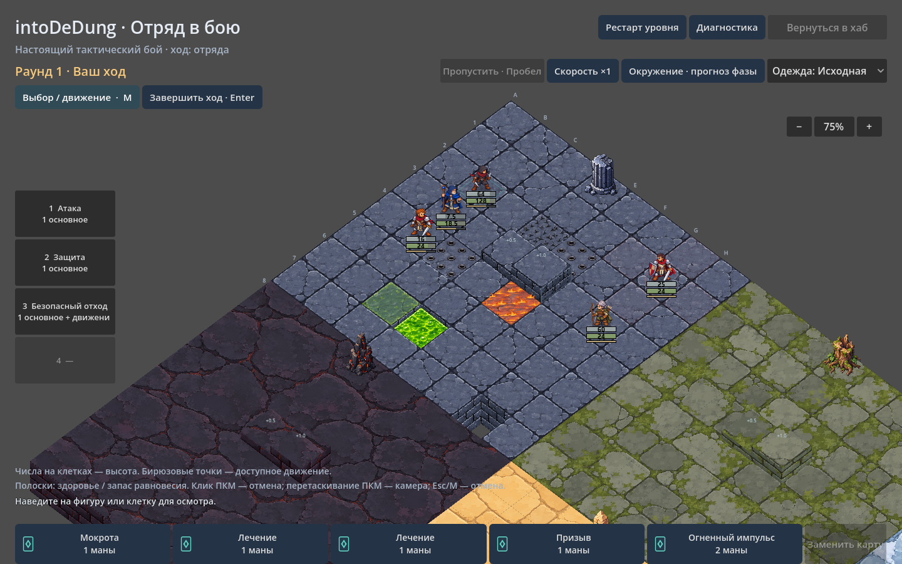

# Фиксированные полосы9px с непиксельными числами — внедрение

U принял [пробу](../vitals-smooth-fixed-20261109/README.md) и поручил её внедрить.
HP/броня теперь сохраняют48×9 экранных px при отдалении; число Play Bold со
сглаживанием остаётся того же размера. Равновесие48×4 также не уменьшается.
Цвета, чёрные числа и рамки прежние. Точное поведение/редкие длинные значения —
[контракт](../../BATTLE_PRESENTATION_REWORK.md); устройство — [архитектура](../../ARCHITECTURE.md).

Только полосы вынесены в дочерний VitalsHud над полем, ниже основного интерфейса
и карточки персонажа: на реальном поле передние плитки срезали нижние края
прежнего локального рисунка при75%. Статусы остаются на прежних местах,
значки и подложка скрыты без наведения. Предложение компактного ряда C не внедрено.
Core, гамма, арт-ресурсы, боевые значения и правила выбора персонажа не менялись.

## Кадры штатной отрисовки

Это настоящие сцены пяти классов и текущая карта. Для сравнения использованы
синтетические опубликованные количества, анимации остановлены. В probe нет
подмены renderer или StatusHud. PNG скопированы побайтно из GPU-захвата.

| Камера / canvas | Кадр |
|---|---|
| 100% | [battle-100.png](battle-100.png) |
| 75% | [battle-75.png](battle-75.png) |
| Камера100%, canvas113% с дробным смещением | [battle-canvas-113.png](battle-canvas-113.png) |

## Проверки и границы

Isolated import/startup PASS. GPU: unit_vital_bars488/0, presentation_status158/0,
presentation_contact414/0, unit_visual_contract45/0, visual_scene_contract106/0,
current_art_zoom520/0, status_counter_layout67/0, battle_camera_ui112/0,
battle_hud_input163/0, battle_character_card119/0.

[Probe](probe_runtime.gd.txt) проверил15 точных RGBA-совпадений с принятой пробой
и30 при смене camera/canvas без явного redraw, а также неизменность core/RNG.
Сводка — [probe.json](probe.json), SHA — [manifest.json](manifest.json).
Отчёт/логи/галереи — `test_reports/vitals-smooth-integration-20261109/`.
Независимое ревью кода, кадров и пакета: APPROVE, без блокирующих замечаний.

Full/core, ручные F5/движение/zoom/OS-DPI/usability/performance не запускались.
Автоматические кадры не заменяют отзыв U о внедрённом результате в бою и
читаемости плотных групп на малом масштабе. Прежние проверки других этапов
и их APPROVE не считаются повторёнными.
