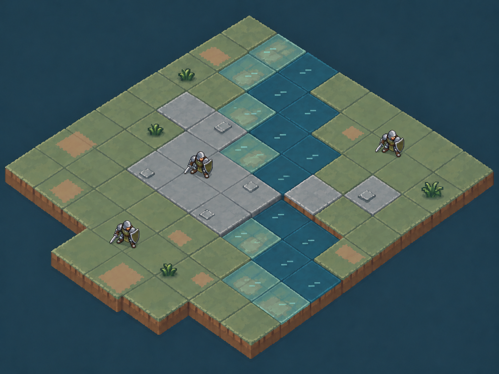

# Воин на тайлах и собранная сцена — 2026-10-18

U попросил поставить приложенного воина на новые тайлы, затем собрать сцену.
Последнее уточнение: **цвета и аккуратность первого листа, размер воина
относительно тайла — второго**. Это выбор для концепта, не изменение игрового пресета.

[Собранная сцена](scene-final.png): трава, камень, мелководье с немного видимым
дном и глубокая вода без дна; три воина на сухих клетках.
Фигуры визуально занимают примерно половину ширины отдельной клетки, как
на втором листе. Спокойная оливковая/серая/сине-зелёная палитра ориентирована
на первый лист. Ровно8×8 и математически точная сетка не подтверждены.

## Сохранённые варианты

| Файл | Назначение |
|---|---|
| [Первый лист](sheet-01-calm-colors.png) | Выбранные U цвета и аккуратность; меньший размер фигур не выбран |
| [Второй лист](sheet-02-larger-scale.png) | Выбранная U пропорция фигуры к тайлу; более яркие цвета не выбраны |
| [Повторно приложенный первый лист](user-preferred-colors.png) | Отдельный пользовательский PNG, не побайтный дубликат первого выхода |
| [Первая сборка](scene-draft-01-oversized.png) | Отвергнута: фигуры около ширины клетки, цвета ярче нужного |
| [Спокойная сборка](scene-draft-02-calm.png) | Отвергнута: фигуры ещё крупнее ориентира, вертикальная водная грань |
| [Итоговая сборка](scene-final.png) | Исправлены масштаб и центральный водный стык; ждёт отзыва U |

[Приложенный воин](../battle-palette-scenes-20261017/pixel-v3/warrior-style-reference.png),
[Брод/Руины V4](../battle-palette-scenes-20261017/pixel-v4/README.md).
Первоначальное сравнение листов со
[старой посадкой](../placement-reference-20261009/user-reference.png)
не прошло по масштабу. Последующее явное указание U выбирает второй лист
для этого концепта; старый игровой контракт посадки не переписан.

## Происхождение и проверка

[Полные промпты, входы и оригиналы провайдера](provenance.json);
[визуальное ревью](review.md); [сохранность и проверки](validation.json).
Провайдер ImageGen; все PNG скопированы без перекодирования, оригиналы сохранены.
Промпт с альтернативным первичным референсом был подготовлен, но НЕ выполнялся;
это явно отмечено в provenance. Ни один предыдущий рисунок не перезаписан.

Ведущий/game_reviewer: APPROVE для иллюстративного концепта.
Точные RGB/hex, геометрия, пиксельная идентичность воина, anchors и игровая
читаемость не подтверждены. Водные примеры на листах не задают погружение,
проходимость или стоимость движения; в итоговой сцене фигуры стоят на суше.
Нет новых Godot/full/core/F5/editor/DPI/GPU, runtime или финальной
художественной приёмки U. Игра, approved-ассеты и баланс прежние.
Дальше — отзыв U об этой сборке; внедрение не разрешено.
